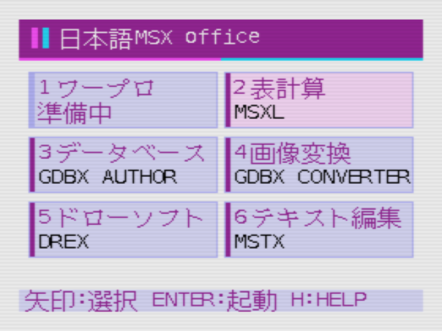

# 日本語MSX Office

日本語MSX2向けのオフィスソフト集です。共通の起動メニューから、表計算、カード型データベースの作成、画像変換、図形描画、テキスト編集を始められます。GDBXで作った閲覧用ディスクは単独で起動できます。

**[公開版 v1.0.0 をダウンロード（ZIP、1.93 MB）](https://github.com/victriokook/Japanese-MSX-Office/releases/download/v1.0.0/Japanese-MSX-Office-Public.zip)** · [リリース情報](https://github.com/victriokook/Japanese-MSX-Office/releases/tag/v1.0.0)

[YouTubeで1分間のデモを見る](https://youtu.be/5UCvR9IZSBI)

## ダウンロードから起動まで

日本語MSX2、MSX-DOS 1の起動ディスク、ディスクイメージを編集できるツールを用意します。WindowsではMSX Disk-Manager、エミュレーターではopenMSXを使えます。

1. 上のリンクから配布ZIPをダウンロードして展開します。
2. お手元のMSX-DOS 1起動ディスクのイメージをコピーし、MSX Disk-Managerでコピーを開きます。
3. 展開先の `office-files` フォルダーを開き、中身をディスクのルートに追加します。既存の `AUTOEXEC.BAT` に必要な設定がある場合は、その処理を残して末尾に `SUITE` の行を追加します。
4. ディスクを保存してDisk-Managerを閉じます。openMSXで日本語MSX2（例として Panasonic FS-A1WX）を選び、作成したディスクをAドライブに入れて起動します。
5. メニューが表示されたら、矢印キーでアプリを選び、Enterで起動します。DOSのプロンプトからは `SUITE` と入力してEnterで開けます。アプリを終了してDOSに戻った場合も同じ操作です。

ワープロ欄に手持ちの対応ソフトを登録する方法は、ZIP内の「ワープロ登録手順.md」にあります。各アプリのキー操作は「操作説明書.md」を参照してください。

## 各ソフトの画面

| MSXL｜表計算（メニュー2） | GDBX AUTHOR｜データベース作成（3） |
| --- | --- |
|  |  |
| 日本語の表に数式やグラフを使えます。DATとSYLKに対応。 | 1行ずつカードを入力し、番号を揃えた画像と一緒に閲覧用ディスクへ書き出せます。 |

| GDBX CONVERTER｜画像変換（4） | DREX｜図形描画（5） |
| --- | --- |
|  |  |
| 非圧縮BMPを128×128ドットのGDBX用画像へ変換します。 | マウスで図形を描き、移動、回転、拡大・縮小、グループ化ができます。 |

| MSTX｜テキスト編集（6） | GDBX｜カード閲覧（閲覧用ディスク） |
| --- | --- |
|  |  |
| かな・漢字入力に対応したShift-JISテキストエディターです。 | 画像付きカードのページ送り、一覧、長文表示、検索ができます。 |

## 同梱サンプルとブラウザー版

- **MSXL**　月別売上と計算式の作例 `DEMO.SLK`、売上表 `SALES.SLK`。
- **GDBX**　ガンダム全43話、ローリング・ストーンズの32アルバム、メトロポリタン美術館のOpen Access作品3点。ガンダムとストーンズには公開版用のオリジナル図柄を使用しています。
- **DREX**　信号の流れを示す `FLOW.GRX` と、グループの変形を試せる `GROUP.GRX`。
- **HTML版 GDBX CONVERTER**　展開した `GDBX-CONVERTER.html` をEdgeまたはChromeで開き、元画像とAUTHORの行番号を指定して変換できます。

各サンプルの開き方は、ZIP内の「サンプルとHTML版コンバーター.md」にあります。
